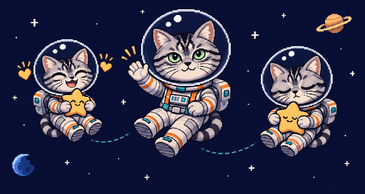
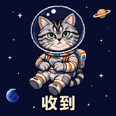
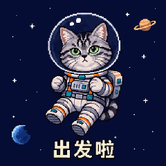
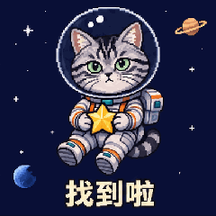
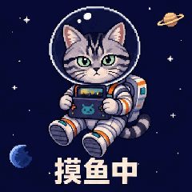
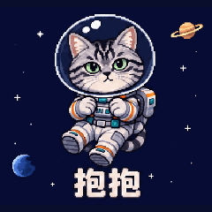
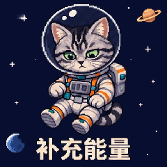
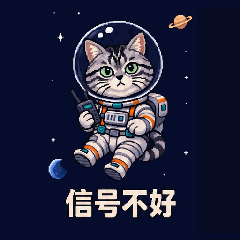
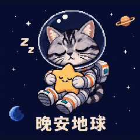
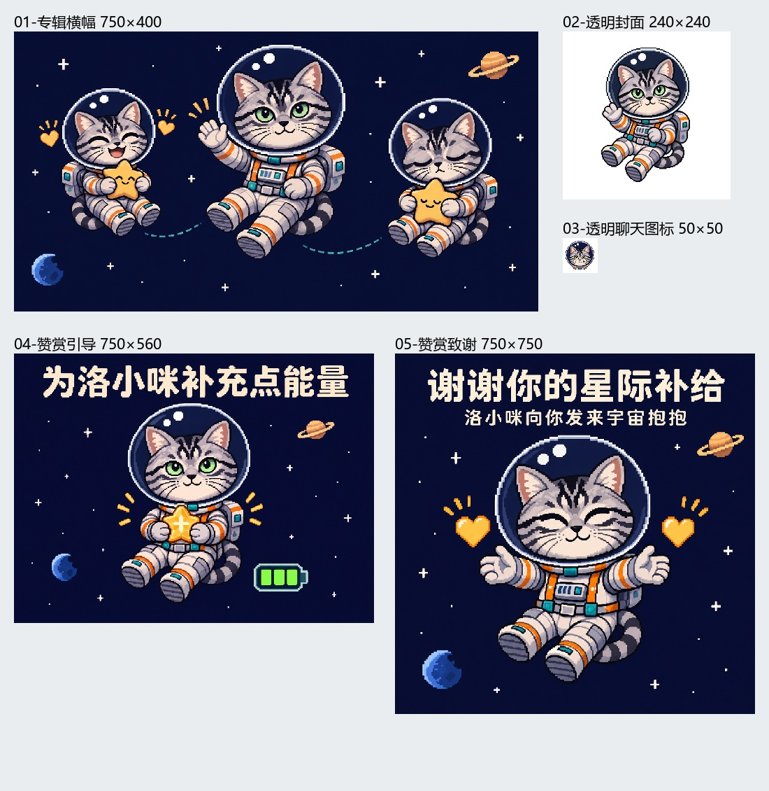

# 洛小咪遨游太空：像素主题案例

状态：**成品、上架信息和五张配图已交付，尚未确认本期上传。** 与黄卫衣「洛小咪的日常2」分开记录，见 [publication.json](publication.json)。



## 实际流程

1. 沿用洛小咪的银灰黑色虎斑、绿眼睛和圆脸，用户选择像素风。
2. 用户指定“遨游太空”主题，服装换成白灰宇航服、橙色绑带和青绿色配件，背景换成深蓝星空与远处星球，动作换为失重漂浮。助手生成并交付 [512×512静态参考图](reference.png)，用户确认。
3. 助手设计8个聊天动作，交付 [8条独立完整GIF提示词](prompts.md)，用户自行在网页入口生成。
4. 用户提供8张实际GIF。首、中、末抽帧确认系列为像素风；均为9帧、1.98秒无限循环。原始尺寸不统一，部分不是正方形，详见 [源文件检查](source-audit.json)。
5. 用户先要求上架信息，交付名称、介绍、AIYasupo署名、赞赏语与表情顺序；随后要求图片，再分别制作五张配图。配图从实际像素GIF取参考帧，保持本套角色与风格。
6. 本仓库另附240×240上传示例副本和120×120缩略图。使用最近邻等比缩放与深蓝补边，保留源帧数、循环与总时长，源GIF原样保存。按工作配置验证清单并可重建ZIP。

## 已完成的8个动作

| 收到 | 出发啦 | 找到啦 | 摸鱼中 |
| --- | --- | --- | --- |
|  |  |  |  |

| 抱抱 | 补充能量 | 信号不好 | 晚安地球 |
| --- | --- | --- | --- |
|  |  |  |  |

## 可直接复用的交付参考

- [专辑清单](album.json)、[上架信息](publishing.json)、[GIF提示词](prompts.md)、[五张配图提示词及参考图角色](asset-prompts.json)。
- [横幅750×400](assets/banner.png)、[透明封面240×240](assets/cover.png)、[透明图标50×50](assets/icon.png)、[引导图750×560](assets/support.png)、[致谢图750×750](assets/thanks.png)。
- 三张不透明配图另附 `-light.jpg`；封面、图标使用透明PNG。
- originals为8张原始GIF；stickers为8张上传示例副本，二者不重复计为16个独立作品。原始文件不自动进入上传ZIP。



上架名称为「洛小咪遨游太空」（7字符），介绍75字符，署名AIYasupo，赞赏语「为洛小咪补充点能量」（9字符）。致谢标题「谢谢你的星际补给」，副标题「洛小咪向你发来宇宙抱抱」。完整文案见publishing.json。

## 风格比较边界

用户另外看过一张 [Q版三维太空静态试样](style-previews/space-3d-candidate.png)。该图为512×512的候选参考，用户未确认采用；不代表已制作三维版GIF，也未用于本套发布配图。像素成品与三维候选分别保存，依据实际成品选择包装画风。

## 检查范围与复现

本例完成格式、帧数、循环、时长和尺寸技术检查、首中末抽帧观察，以及配图文字和最终缩小尺寸检查。未记录完整逐帧视觉验收或正常播放审核通过。技术检查不保证最新微信提交要求或平台审核通过；主题背景为不透明深蓝，封面图标另做真实透明图。

在仓库根目录运行：

```bash
python scripts/sticker_pack.py audit --manifest examples/luoxiaomi-space/album.json --report build/space-report.json
python scripts/sticker_pack.py pack --manifest examples/luoxiaomi-space/album.json --output build/space-upload.zip
```

按现有配置导出的副本只是准备材料，实际提交以当前微信入口为准。用户后续确认上传、退回、通过或上线时，再更新publication.json；不沿用其他专辑的状态。原始照片、私人路径与账号资料不在公开案例中。
