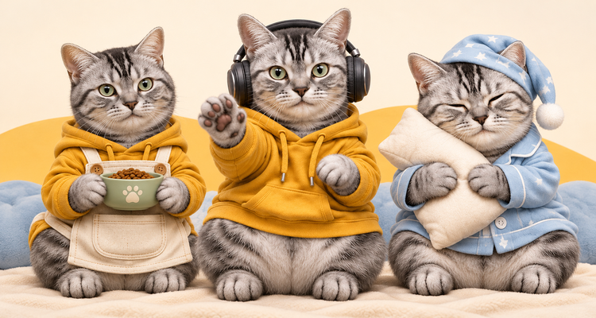
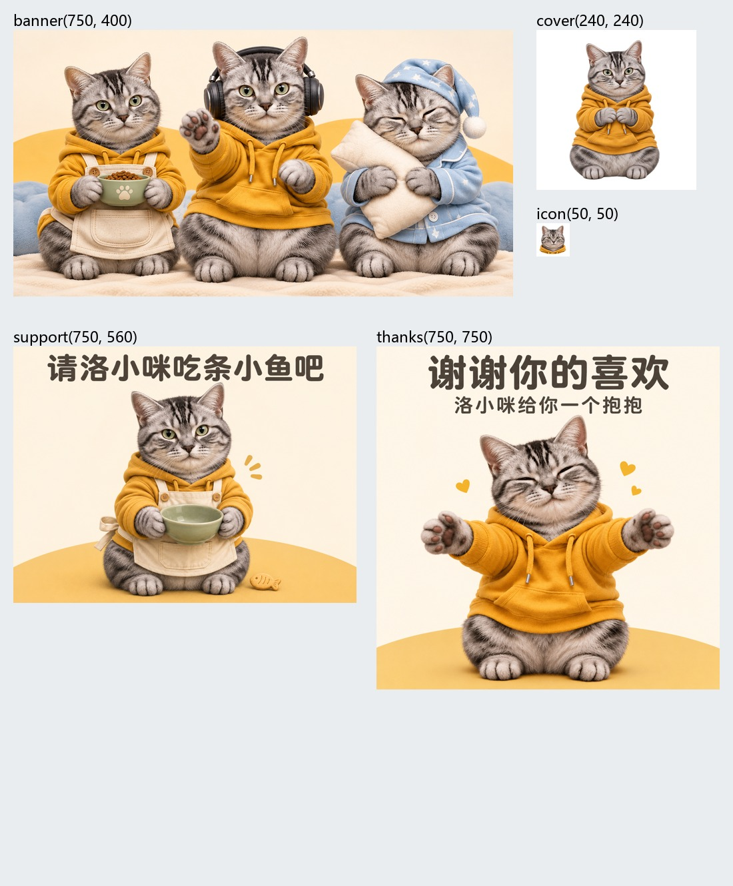
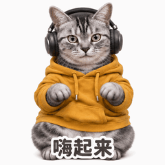
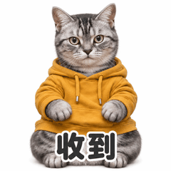
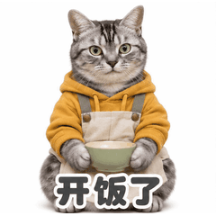
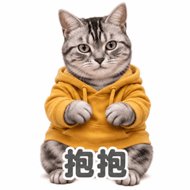

# 洛小咪的日常2：从选风格到微信待审核

状态：**2026-11-06，用户报告已上传微信，待审核**。尚无审核通过或公开上线结果，见 [publication.json](publication.json)。

## 本例流程

1. 用户提供猫咪照片。先识别银灰黑色虎斑、绿眼睛、圆脸、额头M形纹路，按实例库提供照片拟人、Q版插画、像素等方向。
2. 用户选“照片质感＋穿衣服、拿道具”。生成黄卫衣、黑耳机、举爪的单角色静态试样，用户认可。仓库提供该造型的 [512×512静态参考交付版](reference.png)，高分辨率原始试样经等比补边后符合尺寸；此交付版在归档时导出。
3. 设计嗨起来、收到、开饭了、不想上班、摸鱼中、抱抱、气鼓鼓、晚安，交付 [八条可独立复制提示词](prompts.md)。
4. 用户自行在网页端生成8张GIF并提供成品。读取格式、帧数、时长、循环、尺寸与白底属性，并抽看首、中、末帧。原始成品为4–8帧，约1.98–2秒，尺寸439–627px且含少量非正方形。
5. 保留原GIF，另做240×240等比补白上传副本，核对帧数、循环和总时长，导出120×120缩略图。白底仍为白底。
6. 依据最终成品生成五张配图，核对真实尺寸、透明通道、中文字和50px图标；制作专辑文案，署名按用户确认填AIYasupo。
7. 检查album.json引用的21个媒体文件，输出上传ZIP和填写信息。用户完成微信上传，当前待审核；后续按实际结果记录修改、通过或上线。

## 交付文件

- [造型参考](reference.png)、[专辑清单](album.json)、[提示词](prompts.md)、[填写信息](publishing.md)。
- stickers：8张240×240 GIF；thumbnails：8张120×120 PNG。
- assets：750×400横幅、240×240透明封面、50×50透明图标、750×560赞赏引导、750×750赞赏致谢；三张不透明配图另有轻量JPEG。

| 嗨起来 | 收到 | 开饭了 | 抱抱 |
| --- | --- | --- | --- |
|  |  |  |  |

## 检查与状态边界

本例完成技术检查、首中末抽帧检查与五张配图视觉检查。未将技术统计当作逐帧视觉验收，也未记录完整播放审核通过。用户报告上传不代表已审核通过。当前规格页未能读取，采用技能工作配置，体积上限和白底规则以实际提交页为准。

这些为用户授权公开的AI辅助流程示例，署名AIYasupo。不会把该署名默认填入其他人的作品。照片原件、机器路径、账号信息与临时文件不进入仓库。
